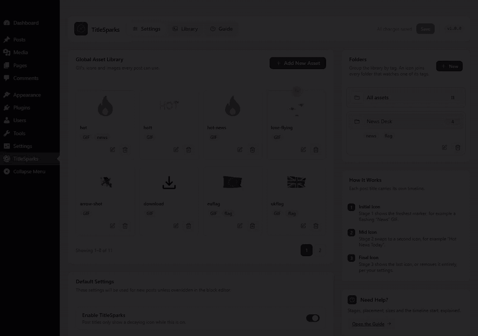
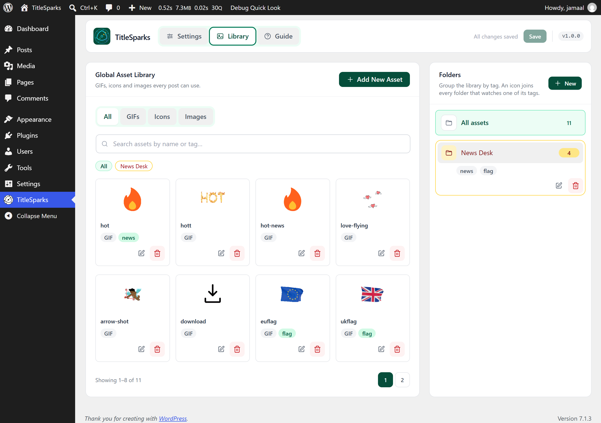
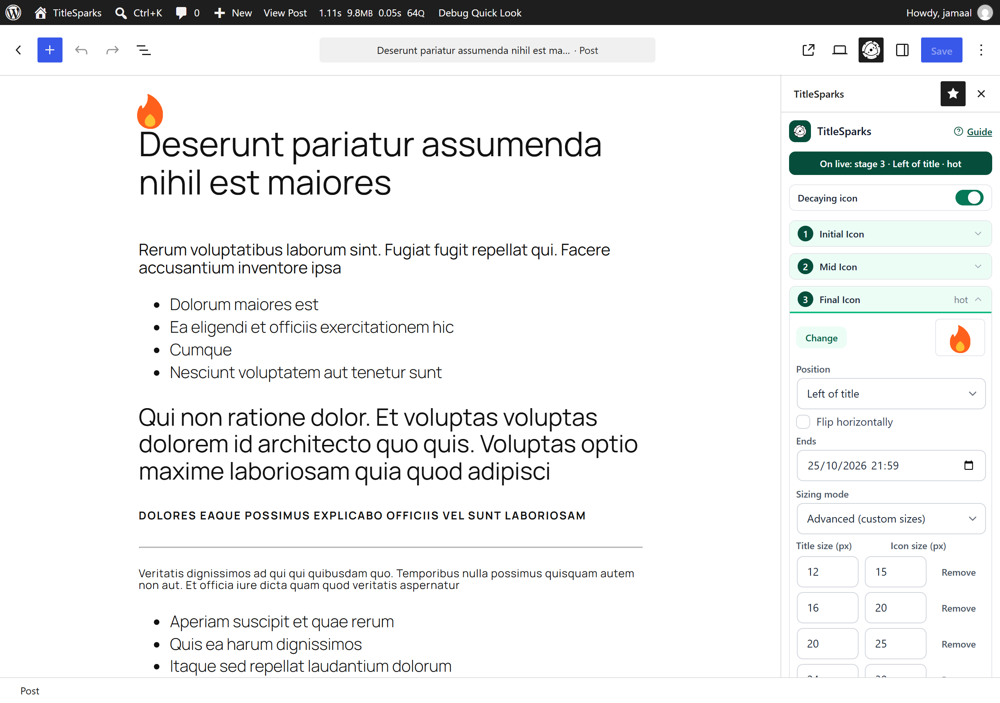
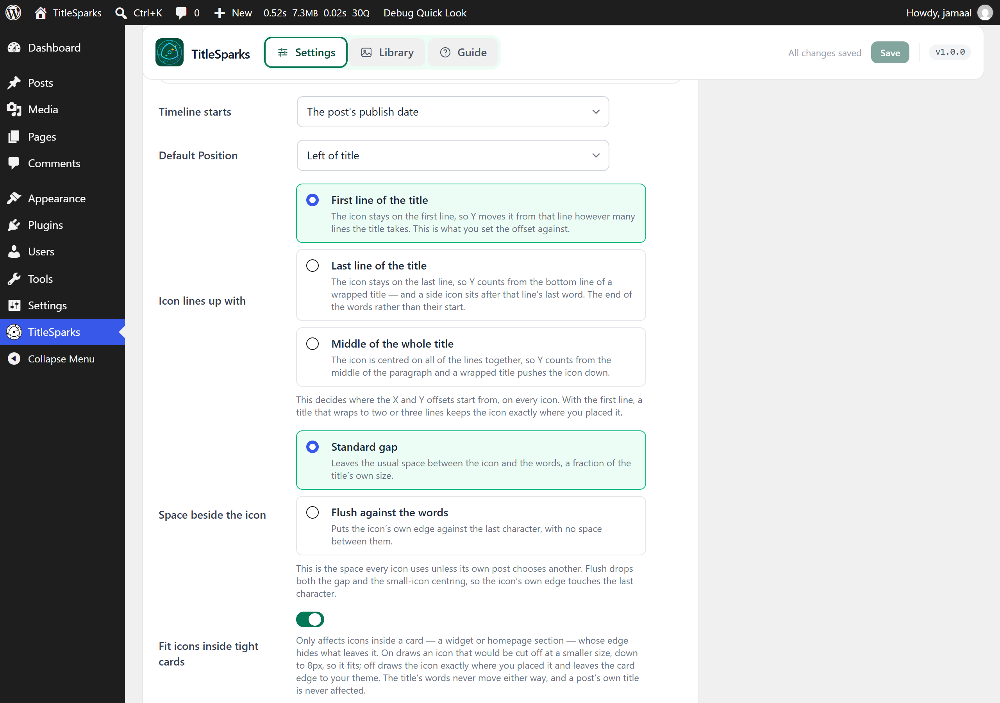
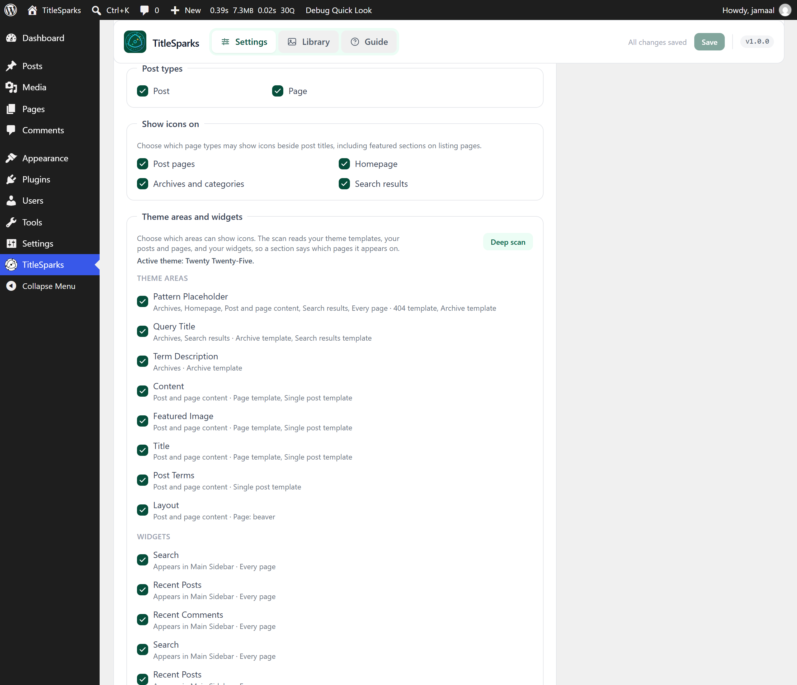
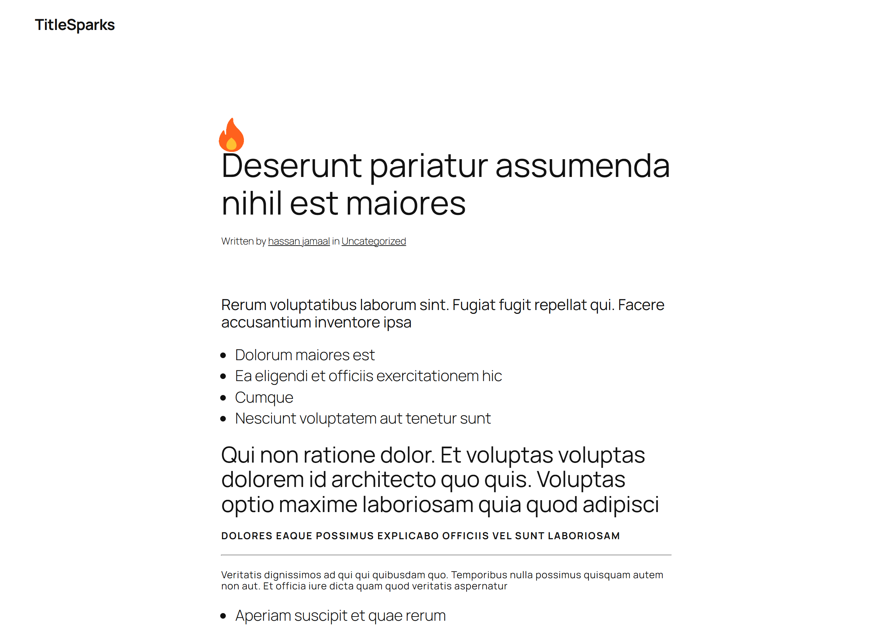
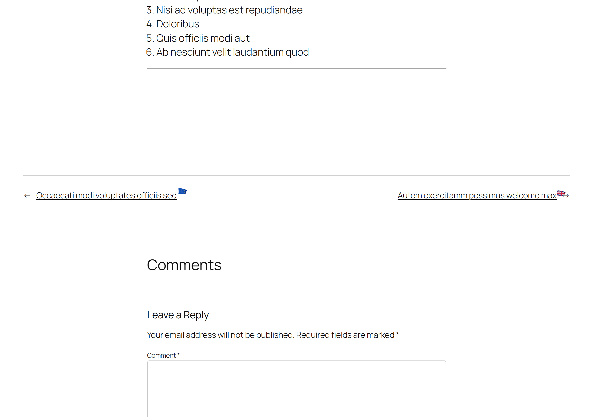
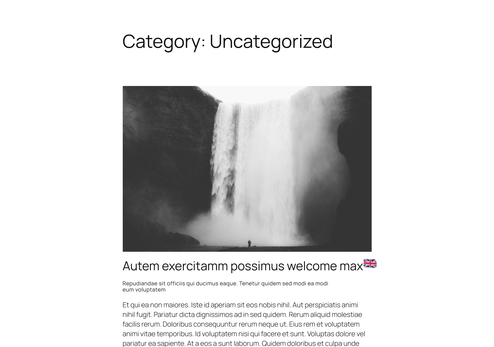

# TitleSparks

[](https://github.com/AhsanulBarakah/titlesparks/actions/workflows/tests.yml)
[](https://github.com/AhsanulBarakah/titlesparks/actions/workflows/plugin-check.yml)
[](https://github.com/AhsanulBarakah/titlesparks/actions/workflows/security.yml)
[](https://github.com/AhsanulBarakah/titlesparks/releases/latest)
[](https://github.com/AhsanulBarakah/titlesparks#requirements)
[](https://playground.wordpress.net/?plugin=https%3A%2F%2Fgithub.com%2FAhsanulBarakah%2Ftitlesparks%2Freleases%2Flatest%2Fdownload%2Ftitlesparks.zip&url=%2Fwp-admin%2Fadmin.php%3Fpage%3Dtitlesparks)

Attach customizable images, icons, and animated GIFs to post titles, with a
three-stage expiration timeline.

TitleSparks gives every supported post a visual status marker. You build one
library of assets, then each post carries its own timeline: the icon an author
picks is drawn beside the title, and it changes — or disappears — as each stage
expires. The same icon follows the title everywhere that title is printed, so a
reader sees it on the post itself, in an archive card, in a sidebar's
latest-posts list, and on the previous/next links that point at it.

- A global asset library with tags, folders, search, and type filters.
- A deep scan of your theme's templates, your posts and pages, and your widgets,
  with an independent switch for each theme area, each widget, and each page
  type.
- Per-post timelines with three configurable stages and a live icon in the
  editor.
- Settings for the supported post types, the default position, spacing, and
  timeline behavior.

A typical use is a badge that ages on its own: a post wears a "New" badge
today, switches to a quieter icon after a day, and loses the icon entirely after
a week, without being edited again. Each of the three stages says how long it
lasts, and the plugin works out which one is live from the post's own date or
from a start date you set.

`readme.txt` is the WordPress.org directory's copy and is deliberately short —
the header, a brief description, installation, a few questions, the screenshot
captions, the source pointer, the changelog and the upgrade notice. This file and the guides under
[doc/](doc/README.md) carry the detail.

## Try it in your browser

[Open TitleSparks in WordPress Playground](https://playground.wordpress.net/?plugin=https%3A%2F%2Fgithub.com%2FAhsanulBarakah%2Ftitlesparks%2Freleases%2Flatest%2Fdownload%2Ftitlesparks.zip&url=%2Fwp-admin%2Fadmin.php%3Fpage%3Dtitlesparks)
— a complete WordPress with the newest release installed and activated, running
in the browser, landing on the plugin's settings screen. Nothing is installed on
any site of your own.

The link installs the newest release's ZIP, so it needs that release to exist and
to be readable by the browser that opens the link: the repository and its
releases have to be public for it to work for anyone else. Once the plugin is in
the WordPress.org directory, its slug can replace the ZIP URL
(`?plugin=titlesparks`), which needs no repository at all.

## Screenshots

A ten-second loop through the library — a folder narrowing its eleven assets to
the four it holds — and then a post page whose title carries one of them.



The same clip as video, if you want a player and a smaller download:
[demo.mp4](demo.mp4) (silent, 1280x900) or [demo.webm](demo.webm).

1. The asset library, with its tags, folders, search box and type filters over
   every icon, image and animated GIF the site can attach to a title.

   

2. A post's timeline in the editor sidebar: the stage that is live, its asset,
   position, expiry date and size scale, with that icon drawn on the real title
   in the canvas.

   

3. Default settings: the position of an icon, the line of the title it lines up
   with, the space beside it, and the switch that fits icons inside tight cards.

   

4. Supported post types and the page types that show icons, above the Theme
   areas and widgets list, where each area's switch names the pages it appears
   on and each widget's switch names the sidebar it sits in.

   

5. A post's own page: the icon beside the article title, at the size and
   position that post's own timeline asks for.

   

6. The previous and next links at the foot of a post, each carrying the icon of
   the post it points to.

   

7. An archive or the homepage, where every copy of a title is decorated and each
   card's icon is sized from that card title's own size.

   

These are the same seven captions, in the same order, as the `== Screenshots ==`
section of [readme.txt](readme.txt), which is the copy WordPress.org pairs with
the numbered files.

## Requirements

- WordPress 6.6 or later.
- PHP 7.4 or later.

## Installation

1. Download `titlesparks.zip` from the
   [latest release](https://github.com/AhsanulBarakah/titlesparks/releases/latest),
   or build it with `npm run plugin-zip`.
2. Install it through **Plugins → Add New → Upload Plugin**, and activate it.
3. Open **TitleSparks** in the administration menu to choose the supported post
   types and the default timeline behavior.
4. Edit a supported post to give it its own timeline.

## Frequently asked questions

### Which WordPress and PHP versions are required?

WordPress 6.6 or later and PHP 7.4 or later.

### How does the timeline work?

Each post can use up to three stages. The icon changes as each stage expires,
using the timeline defaults configured in the TitleSparks settings, and the
stages carry their own assets, so a timeline is built once and then runs by
itself.

### Does the icon stay right when a page is cached?

Yes. The page carries every stage's start and end time with its icon, and the
browser picks the stage that is live from its own clock. A cached page therefore
shows the stage a reader should see rather than the one that was live when the
page was written, and an open page switches stage on its own when the next one
begins.

### Does it work with classic themes and block themes?

Yes. The icon is placed into the finished page in the browser, so nothing special
has to be printed by the theme. It works with a classic PHP theme and with a
block theme alike, and the theme areas the deep scan finds can each be switched
off on their own.

### Does it slow my site down?

The front end loads one small script, and only on pages that have an icon to
place or that contain a widget or theme section enabled for icons. A small
stylesheet loads on every page while the plugin is switched on. The scan of your
theme's templates is cached, and the cache is rebuilt in the background when
something it reads changes rather than during a visitor's request.

### What about visitors who prefer less motion?

An animated GIF cannot be paused with CSS, so a visitor whose system asks for
less motion is shown a still frame of that GIF instead. This is on by default and
can be switched off in Settings.

### What happens when I delete the plugin?

Deleting TitleSparks removes its settings, every post's timeline, and the still
frames it made for animated GIFs. Your images in the Media Library are kept.

### Will it change my post titles?

No. The title text is never changed, filtered or rewritten: the icon is placed
beside the title in the browser, after the page has loaded.

## Documentation

The [documentation index](doc/README.md) links every guide. The ones most people
need first are the [user guide](doc/user-guide.md), the
[settings reference](doc/settings-reference.md), and
[troubleshooting](doc/troubleshooting.md).

## Development

```bash
npm ci
npm run build        # build-admin, build-block and build-frontend
npm run test:unit
npm run lint:js
```

Three bundles are built independently — the settings dashboard, the editor
sidebar, and the front end — and the PHP loaders read each `.asset.php`
manifest, so a build is required before the plugin behaves like a source change.

Each bundle has exactly one entry:

- `blocks/admin/` → `build-admin/` — the TitleSparks dashboard.
- `blocks/sidebar/` → `build-block/` — the timeline sidebar in the block editor.
- `blocks/frontend/` → `build-frontend/` — the icons placed on the front end.
- `blocks/shared/` — the modules those three use in common.

The release ZIP ships only the compiled output in `build-admin/`, `build-block/`
and `build-frontend/`; the readable sources in `blocks/` stay in this repository,
and `npm ci && npm run build` is the way from a source change to the shipped
files. Nothing in either place is minified beyond webpack's own output, and
nothing is obfuscated.
[Testing and tooling](doc/testing-and-tooling.md) covers the live checks that run
against a real WordPress install, and
[release and maintenance](doc/release-and-maintenance.md) covers packaging and
the release checklist.

## Supporting the plugin

TitleSparks is maintained in unpaid time. If it earns its place on your site and
you want to say thanks, you can
[buy me a coffee](https://www.buymeacoffee.com/jamaaldev). Nothing in the plugin
depends on it — no feature is held back, and no reminder is shown in the admin.

## License

GPL-2.0-or-later. See [LICENSE](LICENSE).

## Credits

- [jamaaldev](https://profiles.wordpress.org/jamaaldev/) — plugin author, also
  on WordPress.org as
  [ahsanulbarakah](https://profiles.wordpress.org/ahsanulbarakah/).
- The icons and animated GIFs shown in the screenshots and in [demo.gif](demo.gif)
  can be found on [Pixabay](https://pixabay.com/).
